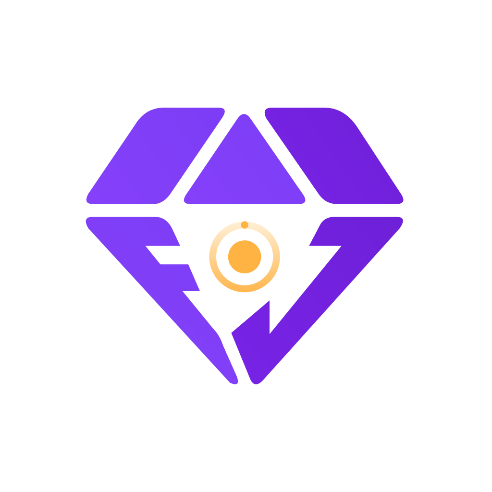

<p align="center">
  
</p>

<h1 align="center">FocusJoy</h1>
<p align="center"><strong>Focus with purpose. Make progress you can see.</strong></p>
<p align="center">An open-source Flutter app for focused work, digital wellbeing, everyday planning, and mindful breaks.</p>
<p align="center">
  <a href="LICENSE">GPL-2.0</a> ·
  <a href="docs/SETUP.md">Developer setup</a> ·
  <a href="CONTRIBUTING.md">Contribute</a> ·
  <a href="https://github.com/techerrorNR/Manodhyan/issues">Report an issue</a>
</p>

## Why FocusJoy?

Putting your phone down is easier when progress feels rewarding. FocusJoy combines focus sessions with collectible gems, practical distraction controls, a planner, and short maths practice sessions. The aim is to help people spend their time intentionally while keeping useful tools together.

**Flutter developers, Android developers, designers, translators, and testers are welcome.** Improve an existing feature, investigate a device-specific issue, or propose something useful in [Issues](https://github.com/techerrorNR/Manodhyan/issues). Read the [contribution guide](CONTRIBUTING.md) before starting a larger change.

The repository retains its original name, **Manodhyan**; the app is now **FocusJoy**. Some internal classes and platform identifiers still use the earlier name.

## What is included?

| Area | Features in the codebase |
| --- | --- |
| Dashboard | Focus and activity insights, gem progress, and a future-updates section |
| Focus | Swipe to start, configurable sessions, focus rules, session history, and rewards |
| Gems | Duration-based collectible tiers and focus points from completed sessions |
| Planner | Tasks, alarms, and saved notes in one place |
| Floating shortcut | Draggable Focus button with a saved position; Android overlay service for use over other apps |
| Activity | App usage statistics and digital wellbeing insights |
| Tools | App restrictions, restriction groups, shorts blocking, website blocking, bedtime routines, notification controls, and parental-control settings |
| Mental Maths | Addition, subtraction, multiplication, division, difficulty levels, timed/practice modes, results, and local history |
| Appearance | Shared navy, purple, and amber palette, FocusJoy artwork, and an animated splash |

Android system features depend on permissions and device behavior. Their presence in the codebase does not mean every manufacturer or OS version has been verified. See [setup and device testing](docs/SETUP.md).

### How focus rewards work

A successfully completed session earns one collectible according to its duration:

| Completed focus time | Gem |
| --- | --- |
| Under 5 minutes | No collectible |
| 5–9 minutes | Amber |
| 10–14 minutes | Amethyst |
| 15–29 minutes | Aquamarine |
| 30–59 minutes | Emerald |
| 60+ minutes | Ruby |

Successful sessions also earn one focus point per whole completed minute. Failed sessions earn neither points nor gems. Rewards are calculated from completed-session records to avoid awarding the same session twice. Gems are in-app collectibles without a cash value. See [`focus_reward.dart`](lib/models/focus_reward.dart) for the rules.

Mental Maths has a **10-minute daily allowance**, designed to be shared with future mindful games. It is a practice activity; no IQ improvement is promised.

## Run locally

Android is the primary development target. Start with **Flutter 3.41.4 / Dart 3.11.1** (the current development environment), **JDK 17**, and **Android SDK Platform 36**. This is a setup reference, not a claim that every feature has been tested on that toolchain. Other Flutter versions need compatibility checks; the SDK is not pinned in this repository.

```sh
git clone https://github.com/techerrorNR/Manodhyan.git
cd Manodhyan
flutter --version
flutter doctor -v
flutter doctor --android-licenses
flutter pub get
flutter devices
```

Choose an Android device ID from the list, then run:

```sh
flutter run -d YOUR_ANDROID_DEVICE_ID -t lib/main.dart
```

For contributions, fork the repository and clone your fork instead. No Firebase project, backend server, paid service, or API key is required for the current app setup. First-time Flutter setup, Android permissions, troubleshooting, tests, and build instructions are in the **[full setup guide](docs/SETUP.md)**.

## Project map

```text
lib/
  main.dart              App entry point, providers, splash, navigation
  controllers/           Planner, alarms, timer, notes, and maths state
  models/                Rewards, alarms, tasks, notes, and maths models
  screens/               Planner, editors, permission flow, and maths screens
  services/              Scheduling, preferences, floating shortcut, game storage
  widgets/               Shared UI, rewards, splash, and floating controls
  mind/                  Digital wellbeing foundation
    core/database/       Drift tables, DAOs, and generated database code
    core/services/       Native bridge and database services
    providers/           Riverpod state for wellbeing features
    ui/                  Navigation, dashboard, activity, tools, settings
    l10n/                Translation sources and generated localizations
android/app/src/main/
  AndroidManifest.xml    Permissions and Android components
  kotlin/com/sjtechnovation/focusjoy/
                         Native services, platform channels, and receivers
assets/                  Gems, logo variants, illustrations, and vectors
test/                    Focus, alarms, notes, overlay, and maths tests
tools/                   Branding asset generation
```

The code uses both **Provider** and **Riverpod**. Storage includes **SQLite through Drift** for the wellbeing foundation and **SharedPreferences** for planner/settings/game data, plus native preferences where needed. There is no implemented cloud sync or online leaderboard. See [architecture notes](docs/SETUP.md#architecture-and-generated-code) before changing storage or platform code.

## Development checks

```sh
flutter analyze
flutter test --no-pub test/focus_reward_test.dart test/notes_controller_test.dart test/mental_math_test.dart test/alarm_scheduling_test.dart test/floating_focus_test.dart
```

The targeted suite above covers the newer features. `test/widget_test.dart` is still the Flutter starter counter test and does not match FocusJoy; a blanket `flutter test` run includes it. Replacing it with a properly initialized app smoke test is a welcome contribution. Do not assume the whole repository has a clean analysis baseline; report unrelated findings separately.

## Where we want to go

These are proposed directions, **not shipped features or delivery promises**:

- Task-linked alarms and clearer task reminder workflows.
- More short mindful games, including an 8×8 Sudoku variant with clearly defined rules, plus memory and attention exercises.
- A thoughtful ranking system built around focus progress.
- Better accessibility, translations, onboarding, and small-screen layouts.
- More Android device testing for alarms, overlays, background execution, and permission recovery.
- Stronger regression coverage and clearer separation of shared UI and platform code.

Have a better idea? Open an issue describing who it helps, how it works, and how it supports intentional phone use.

## Credits and license

FocusJoy builds on **[Mindful](https://github.com/akaMrNagar/Mindful)** by **[Pawan Nagar (@akaMrNagar)](https://github.com/akaMrNagar)** and its contributors. A respectful salute and sincere thanks for sharing the foundation openly. Their work and original authorship deserve clear recognition as this project grows.

Connect with Pawan: [LinkedIn](https://www.linkedin.com/in/akamrnagar) · [Portfolio](https://akamrnagar.vercel.app/) · [GitHub](https://github.com/akaMrNagar).

Continued development and FocusJoy features are led by **[Rakesh Yadav (@techerrorNR)](https://github.com/techerrorNR)** of **[Shree Ji Technovation](https://sjtechnovation.in/)**, with contributions welcome from the community.

Explore our work: [Rakesh Yadav's portfolio](https://rakeshkumaryadav.in/) · [Shree Ji Technovation website](https://sjtechnovation.in/) · [GitHub](https://github.com/techerrorNR).

This repository is shared under the **GNU General Public License v2**, provided in [LICENSE](LICENSE). Preserve applicable copyright, attribution, and license notices when contributing or redistributing. Third-party dependencies retain their respective licenses.
